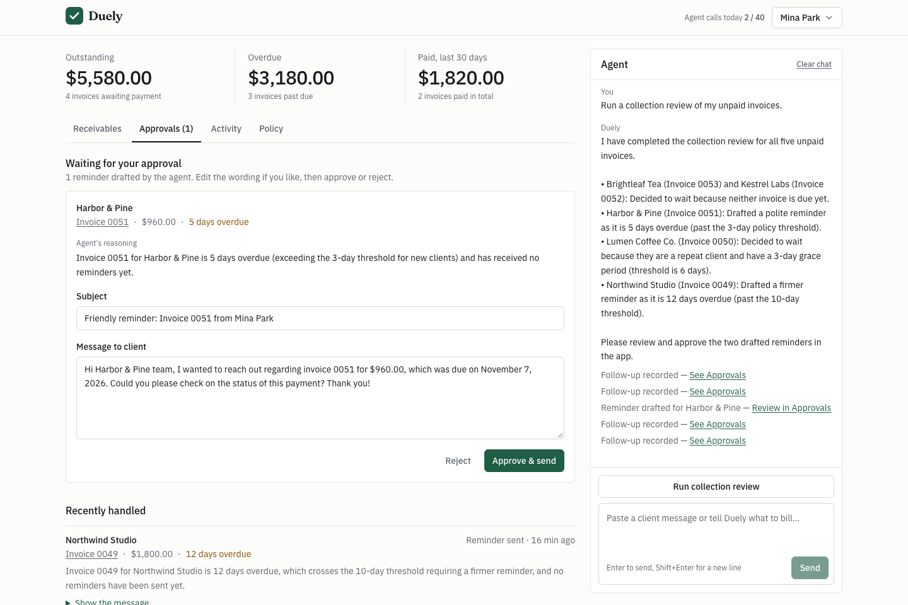

# Duely

**An AI collections agent for freelancers.** Describe the job in plain words, approve the invoice, and the agent follows up with clients on your terms until it is paid — through PayPal.

Built for the [PayPal AI Hackathon](https://paypalaihackathon.devpost.com/).

- **Live demo:** https://duely-00dj.onrender.com (hosted on a free instance: the first request after a quiet period can take up to a minute to wake it)
- **Demo video (2:40):** https://youtu.be/ylH9Hk_fwSY
- **Test account:** see [Try it](#try-it)



## The problem

Freelancers get paid late for a boring reason: sending the invoice and chasing the client are awkward chores that get postponed. With five to ten clients, who is nine days late and who was already nudged lives in your head.

## What Duely does

1. **Describe → draft.** Paste the client's message or say what to bill. The agent extracts client, line items and due date into an editable draft.
2. **Approve → sent.** Nothing reaches a client until you press *Approve & send*. The invoice is then created and sent through **PayPal Invoicing**, with a PayPal-hosted payment page.
3. **Policy in plain language.** "Polite nudge 3 days after due, firm at 10 days, repeat clients get 3 extra days." The agent stores it and applies it.
4. **Collection review.** The agent reads every unpaid invoice and decides, per invoice, to *send a reminder* (it writes the subject and message in the right tone) or to *wait*, and explains why, citing days overdue, reminder history and whether the client has paid before.
5. **Approvals inbox.** Proposed reminders wait for you: edit, approve (sent as a **PayPal invoice reminder**) or reject. Turn on auto-send once you trust the policy.
6. **Paid.** When the client pays on PayPal, a **PayPal webhook** flips the invoice to Paid on the board and withdraws any pending reminder. Payments received elsewhere can be recorded, which also closes the invoice in PayPal.
7. **Activity log.** Everything the agent, you and PayPal did, in order, with the agent's reasoning.

## Try it

Open the live demo and either sign up (any email, no verification) or use the shared test account:

| | |
|---|---|
| Email | `judge@duely.demo` |
| Password | `paypal-hackathon-2026` |

Suggested path (about three minutes):

1. Click **Load sample data** on an empty account. This creates five real invoices in the PayPal sandbox, three of them overdue. (The shared test account already has them.)
2. Click **Run collection review** in the agent panel. Open **Approvals** to see one decision per unpaid invoice, each with its reasoning.
3. Edit a reminder if you like and press **Approve & send**.
4. In the agent panel, paste something like: `Tom from Brightleaf Tea (finance@brightleaf.example) approved the 3 packaging mockups at $350 each plus a $120 rush fee, net 10.` Review the draft and approve it.
5. Open an invoice and press **Record payment**, or pay it for real in the sandbox (below), and watch it flip to Paid.

### Paying an invoice in the sandbox

Open the invoice, follow its **PayPal payment link**, and log in with this sandbox buyer (no real money):

| | |
|---|---|
| Sandbox buyer email | `sb-sfd9r53881494@personal.example.com` |
| Sandbox buyer password | `cUL$sH60` |

Everything runs against the PayPal **sandbox**. No real money moves and no real client is contacted.

## How PayPal is used

| PayPal capability | Where |
|---|---|
| **Invoicing API v2** — create, send, remind, record payment, read, list, delete draft | `server/src/paypal/invoicing.rs` |
| **Webhooks** (`INVOICING.INVOICE.PAID`, `CANCELLED`, `REFUNDED`) with signature verification through `verify-webhook-signature` | `server/src/paypal/webhook.rs`, `server/src/api/webhook.rs` |
| **OAuth 2 client credentials** with token caching | `server/src/paypal/mod.rs` |

PayPal is the source of truth for payment state. A webhook is treated only as a hint: the server re-reads the invoice from the PayPal API before changing anything, and a background reconciler compares unpaid invoices with PayPal every 45 seconds in case a webhook is missed.

## How AI is used

**Google Gemini** (`gemini-3.5-flash-lite` with automatic fallback to other Gemini models), called directly over the `generateContent` REST API with function calling. The model drives a tool loop (`server/src/agent/`) with four tools:

| Tool | Effect |
|---|---|
| `draft_invoice` | Creates a draft for the user to approve. It cannot send. |
| `list_invoices` | Unpaid/paid invoices with days overdue, reminder history and client payment history. |
| `propose_followup` | Records one decision per invoice: a reminder (subject + message) or a wait, with reasoning. |
| `set_policy` | Stores the collection policy the user described. |

Guardrails are enforced in code, not in the prompt: every tool is scoped to the signed-in user; the agent can never send a new invoice; reminders go to the approvals inbox unless the user turned on auto-send, and only the user can flip that switch (the model has no tool for it); all tool arguments are validated server side; text pasted from a client is treated as data.

AI coding assistance: the code was written with Claude Code.

## Architecture

```
web/      React + TypeScript + Vite + Tailwind single-page app
server/   Rust (axum, sqlx, reqwest): JSON API, agent loop, PayPal client, serves the SPA
          Postgres for users, invoices, proposed actions, policy, activity log, quotas
```

One container serves both the API (`/api`) and the built SPA. See `docs/api.md` for the API contract.

Abuse protection for a public demo: accounts with Argon2-hashed passwords and HttpOnly session cookies, same-origin checks on state-changing requests, per-user and global daily limits on agent runs and invoices sent, rate limiting on sign-up, login and PayPal-calling endpoints, and hard limits on reminders per invoice (one per 20 hours, six in total) that hold whatever the policy text or the model says.

## Run it locally

Requirements: Rust (stable), Node 20+, a Postgres database, a PayPal sandbox REST app with **Invoicing** enabled, and a Google AI Studio API key.

```bash
cp .env.example .env        # fill in the values

cd web && npm ci && npm run build && cd ..
cd server && cargo run      # http://localhost:8080
```

For frontend development with hot reload, run `npm run dev` in `web/` (it proxies `/api` to `localhost:8080`).

Note for sandbox setup: PayPal does not let a merchant account send invoices to a payer account in certain same-country combinations (for example Korea to Korea). Use a sandbox buyer from a different country than the sandbox merchant if you want to pay invoices.

To receive webhooks, register `https://<your-host>/api/webhooks/paypal` for the invoicing events in the PayPal developer dashboard and set `PAYPAL_WEBHOOK_ID`. Without it, webhook calls are rejected (they cannot be verified) and the reconciler picks up payments within about 45 seconds.

### Tests

```bash
cd server && cargo test
cd web && npm test -- --run
```

### Docker

```bash
docker build -t duely .
docker run --env-file .env -e COOKIE_SECURE=false -p 8080:10000 duely
```

## Limitations

- USD only.
- All demo accounts share one PayPal sandbox merchant; a production version would connect each freelancer's own PayPal account.
- Reviews run when you ask for them; there is no scheduled daily run yet.

## License

[MIT](LICENSE)
